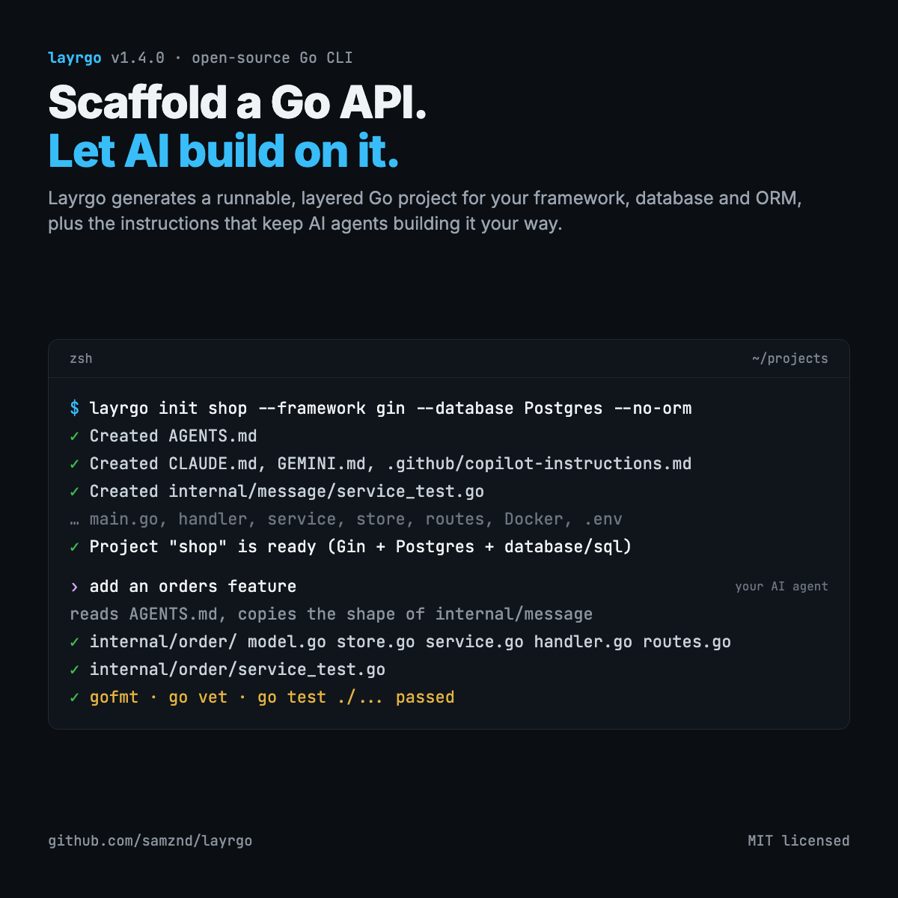

# Layrgo

[](https://pkg.go.dev/github.com/samznd/layrgo)
[](https://github.com/samznd/layrgo/releases)
[](https://github.com/samznd/layrgo/actions/workflows/ci.yml)

<p align="center">
  
</p>

**Scaffold a Go API. Let AI build on it.**

Layrgo is a CLI that generates a complete, compilable Go web project — handler, service and data layers already wired together, dependency injection, `.env` config, Docker, and pinned dependencies — so you start building features instead of wiring boilerplate.

Every project also ships with instructions for AI coding agents, so Claude Code, Cursor, Codex, Copilot and Gemini CLI add features in the same structure, with tests.

## Why Layrgo?

| Without Layrgo                          | With Layrgo                                  |
| --------------------------------------- | -------------------------------------------- |
| Manually wire handlers, services, stores | Pre-wired `handler → service → store`       |
| Pick framework + DB + ORM from scratch  | Choose your stack interactively or via flags |
| Write Dockerfile and compose yourself   | Docker + compose generated per database      |
| Hope the layout is idiomatic            | Standard Go project layout out of the box    |
| AI agents invent a new structure each time | `AGENTS.md` keeps them in your project's shape |

**Supported stacks:** Fiber · Gin · Echo · Chi · Iris · `net/http` × Postgres · MySQL · SQLite × GORM · XORM · Ent · raw `database/sql`

## Quick start

```bash
go install github.com/samznd/layrgo/cmd/layrgo@latest
layrgo init
```

### Non-interactive (scripts, demos, CI)

```bash
layrgo init myapi \
  --framework gin \
  --database Postgres \
  --orm GORM

cd myapi
go run ./cmd
curl http://localhost:3000/api/v1/message
# {"message":"data from the store"}
```

Then open the project in your AI coding tool and ask it to *"add an orders feature"*.
It reads `AGENTS.md` and builds the feature in the project's own shape, with a test.
See [Works with AI coding agents](#works-with-ai-coding-agents).

### Dependency-free routing (`net/http`)

`--framework stdlib` generates a project that routes on the standard library, using
the `http.ServeMux` method patterns added in Go 1.22 — so no router is pulled in:

```bash
layrgo init myapi --framework stdlib --database SQLite --no-orm

cd myapi
cat go.mod        # godotenv + the SQLite driver. No router.
go run ./cmd

curl      http://localhost:3000/api/v1/message   # 200 {"message":"data from the store"}
curl -X POST http://localhost:3000/api/v1/message # 405: the GET pattern routes by method
```

The generated `main.go` uses an explicit `http.Server` with read, write, header and
idle timeouts, rather than `http.ListenAndServe`, which sets none.

### Interactive example

```bash
$ layrgo init
? What is your project name? mywebapp
? Choose your web framework: Gin
? Choose your database system: Postgres
? Would you like to use an ORM? Yes
? Choose your ORM framework: GORM

✅ Project "mywebapp" is ready (Gin + Postgres + GORM)

Next steps:
  cd mywebapp
  go run ./cmd
  curl http://localhost:3000/api/v1/message
```

## Works with AI coding agents

Every generated project includes an `AGENTS.md` written for its exact stack. It
tells an agent how the project is laid out, the rules that keep the layers
apart, the commands that prove a change works, and a complete, compilable
example of adding a feature, using that framework's routing, that database's
SQL placeholders and that ORM's migrations.

One file serves every tool. Codex, Cursor, Windsurf, Zed, Amp and others read
`AGENTS.md` directly; `CLAUDE.md` and `GEMINI.md` import it for Claude Code and
Gemini CLI, and `.github/copilot-instructions.md` points GitHub Copilot to it.
Edit `AGENTS.md` and every tool follows the change.

The sample feature teaches by example too: it ships with a test
(`service_test.go`) and creates its own table at startup (`Migrate`), and agents
copy what they see.

### What we measured

We gave AI agents (Claude Sonnet) the same task, "add an orders feature backed by
Postgres", five times per setup, and tested every result against a real Postgres:

| | Plain Go module | Layrgo + AGENTS.md |
|---|---|---|
| Works end to end | 5/5 | 5/5 |
| Follows `handler → service → store` | 0/5 | 5/5 |
| Wrote tests for the feature | 4/5 | 5/5 |
| Same file layout every run | no | yes |

Before the sample feature shipped with a test, agents working in a Layrgo
project without `AGENTS.md` wrote tests 0 times in 5; with it, 5 times in 5. The
cost of `AGENTS.md` is roughly 7k extra tokens per feature. These are small
samples from one model and one stack, so treat them as a signal, not a benchmark.

## Installation

**Requirements:** Go 1.23+ to install the CLI. Generated projects target your local
Go version; the `stdlib` framework needs Go 1.22+ for `net/http` routing (layrgo
refuses the combination on older toolchains rather than generating a project whose
routes silently 404).

```bash
go install github.com/samznd/layrgo/cmd/layrgo@latest
```

Or build from source:

```bash
git clone https://github.com/samznd/layrgo.git
cd layrgo
make install
layrgo version
```

## Generated project layout

Layrgo packages code **by feature**: everything about one feature lives
in one package, so a change to it touches one directory.

```
your-project/
├── cmd/main.go              # Entry point with DI wiring
├── config/database.go       # DB connection for your stack
├── internal/
│   ├── message/             # One package per feature
│   │   ├── handler.go       # HTTP layer
│   │   ├── service.go       # Business logic
│   │   ├── service_test.go  # Service test with a fake store
│   │   ├── store.go         # Data access, plus Migrate for its table
│   │   └── routes.go        # Route registration
│   └── middleware/          # Ready for your middleware
├── pkg/utils/               # Env loader
├── Dockerfile
├── docker-compose.yml
├── .gitignore
├── .env.example
├── .env                     # gitignored; local overrides
├── AGENTS.md                # Instructions for AI coding agents
├── CLAUDE.md                # Claude Code: imports AGENTS.md
├── GEMINI.md                # Gemini CLI: imports AGENTS.md
└── .github/copilot-instructions.md  # GitHub Copilot: points to AGENTS.md
```

To add a feature, copy `internal/message` to `internal/<name>`, then wire it in
`cmd/main.go`: build its store, call its `Migrate`, and register its routes.
`AGENTS.md` walks through a complete example for your stack.

Interfaces are declared by the code that uses them, and constructors return
concrete types ("accept interfaces, return structs"). The service declares the
one-method `store` interface it needs; `NewStore` returns a `*Store`. A test can
hand the service a fake store without a database, as the generated
`service_test.go` does.

## Commands

```bash
layrgo init                  # interactive wizard
layrgo init myapp --flags    # non-interactive scaffold
layrgo version               # print version
layrgo --help
```

### `init` flags

| Flag          | Description                    |
| ------------- | ------------------------------ |
| `--framework` | Fiber, Gin, Echo, Chi, Iris, or `stdlib` (net/http, no router dependency; needs Go 1.22+) |
| `--database`  | Postgres, MySQL, or SQLite     |
| `--orm`       | GORM, XORM, or Ent             |
| `--no-orm`    | Use `database/sql` instead     |
| `--force`     | Scaffold into a non-empty directory |

## Layrgo repository layout

```
layrgo/
├── cmd/layrgo/          # CLI entry point
├── internal/
│   ├── cli/             # Commands (init, version)
│   ├── scaffold/        # Scaffolding engine
│   ├── templates/       # Template rendering
│   │   └── files/       # The templates, AGENTS.md's included
│   └── fileutil/
├── docs/assets/         # README images
├── scripts/             # Git hooks and their installer
└── .github/workflows/   # CI + release
```

## Development

```bash
make build          # build to bin/layrgo
make run            # build, then run bin/layrgo
make test           # unit tests
make test-integration  # scaffold + go build smoke test
make vet
make clean          # remove bin/
```

Run `scripts/install-hooks.sh` once after cloning to install the repo's git
hooks. Its `commit-msg` hook removes Cursor's co-author trailer from commit
messages.

## Releases

Versioning follows [Semantic Versioning](https://semver.org/) with `v`-prefixed git tags (`v1.0.0`, `v1.1.0`, …, `v1.4.0`).

```bash
# tag a release (triggers GoReleaser via GitHub Actions)
git tag -a v1.4.0 -m "v1.4.0"
git push origin v1.4.0
```

See [CHANGELOG.md](CHANGELOG.md) for release notes.

## Roadmap

- [x] Multi-framework support (Fiber, Gin, Echo, Chi, Iris, net/http)
- [x] Docker + compose per database
- [x] Compilable generated output with DI
- [x] Non-interactive `init` flags
- [x] AGENTS.md for AI coding agents (Claude Code, Cursor, Codex, Copilot, Gemini)
- [ ] `layrgo add feature` for agents and humans
- [ ] GraphQL scaffold
- [ ] gRPC scaffold
- [ ] SQLBoiler support

## License

MIT — see [LICENSE](LICENSE).

## Acknowledgments

- [Standard Go Project Layout](https://github.com/golang-standards/project-layout)
- [Cobra](https://github.com/spf13/cobra) · [Survey](https://github.com/AlecAivazis/survey)
